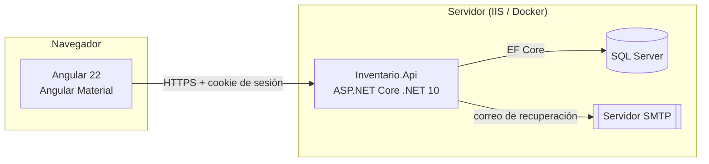
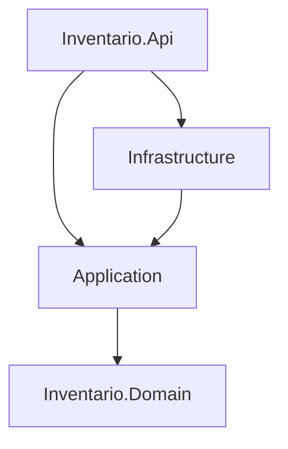

# Arquitectura del Sistema de Inventario TIC

> Documento vivo. Registra **qué** decidimos y **por qué**. Cualquier cambio de arquitectura se anota aquí antes de programarlo.
>
> Versión 0.7 · 23/10/2026 · Cambios: D28 a D30 y reglas 8 a 11 de §6.3 (Paso 4B: gestión de usuarios, roles y sedes).

---

## 1. Propósito y alcance

Sistema web para que **7 sedes** registren y gestionen su inventario de Tecnologías de la Información y Comunicación (TIC): activos, sus componentes (discos, memoria RAM), licencias de software, mantenimientos y asignaciones.

Reglas de negocio que dan forma a la arquitectura:

- Cada sede **solo ve y gestiona su propia información**.
- Cada sede **gestiona sus usuarios y sus roles**.
- Existe un **superadministrador** que ve y gestiona todo.
- Un usuario pertenece a **una sola sede**.
- **No existen transferencias** de activos entre sedes: un activo nunca cambia de sede.

### 1.1 Sedes

| Código | Nombre |
|--------|--------|
| `HUANTA` | Red de Salud Huanta |
| `HUAMANGA` | Red de Salud Huamanga |
| `CENTRO` | Red de Salud Centro |
| `SAN-FRANCISCO` | Red de Salud San Francisco |
| `SAN-MIGUEL` | Red de Salud San Miguel |
| `PUQUIO` | Red de Salud Puquio |
| `CORACORA` | Red de Salud Coracora |

El superadministrador no pertenece a ninguna sede. Se pueden agregar sedes nuevas desde la aplicación (solo el superadmin).

---

## 2. Decisiones tomadas

| # | Tema | Decisión | Motivo |
|---|------|----------|--------|
| D1 | Backend | **.NET 10** (ASP.NET Core) | Versión LTS actual; soportada por el hosting elegido. |
| D2 | Frontend | **Angular 22** (última estable) + **Angular Material** | Pedido del proyecto; Material da componentes accesibles y probados. |
| D3 | Base de datos | **SQL Server** con **Entity Framework Core** | Disponible en el hosting; EF Core da migraciones versionadas. |
| D4 | Arquitectura backend | **Clean Architecture organizada por funcionalidades** + **CQRS ligero** | Responsabilidades separadas, reglas de negocio aisladas de la infraestructura, código fácil de encontrar. |
| D5 | Arquitectura frontend | **Organización por funcionalidades** + **componentes standalone** + **NgRx SignalStore** | Misma lógica que el backend; estado predecible con signals. |
| D6 | Autenticación | **Usuario y contraseña propios** con **ASP.NET Core Identity** y **cookie** HttpOnly | La app sirve el frontend desde el mismo dominio: la cookie es la opción más segura (no hay tokens en el navegador). |
| D7 | Autorización | **Por permisos**; los roles son conjuntos de permisos; **roles configurables por sede** | Permite que cada sede defina sus roles sin tocar código. |
| D8 | Separación por sede | **Columna `SedeId`** en cada tabla de la sede + **filtro global** de EF Core + asignación automática al guardar | Una sola base de datos; imposible olvidar el filtro en un endpoint nuevo. |
| D9 | Catálogos | **Mixtos**: globales (los administra el superadmin) y por sede | Reportes consolidados coherentes entre sedes, sin quitar autonomía local. |
| D10 | Código patrimonial | **Único dentro de cada sede** (no global) | Cada sede ya tiene su propia numeración. |
| D11 | Recuperación de contraseña | **Ambas vías**: enlace por correo (SMTP) y restablecimiento por el administrador | Pedido del proyecto. |
| D12 | Hosting | **SmarterASP.NET** (IIS) ahora; luego **servidor propio con Proxmox** | Toda la configuración por archivos y variables de entorno para que la migración sea solo despliegue. |
| D13 | Mediador | **Sin MediatR** (licencia comercial desde 2025): interfaces de handler propias y registro en DI | Misma claridad, sin dependencia de pago. |
| D14 | Mapeo de objetos | **Mapeo manual** (o Mapperly si crece) | Sin AutoMapper (licencia comercial); el mapeo explícito es más fácil de depurar. |
| D15 | Estilo de API | **Minimal APIs agrupadas por funcionalidad** | Encaja con la organización por funcionalidades; menos ceremonia que los controladores. |
| D16 | Roles por usuario | **Varios roles por usuario**; sus permisos son la **suma** de los de todos sus roles | En las sedes una persona suele cumplir varias funciones; evita crear roles combinados y que un cambio en un rol llegue a todos sus usuarios. |
| D17 | Valores de seguridad | Contraseña de mínimo **10 caracteres**; **bloqueo de 15 min tras 3 intentos fallidos**; sesión que vence a los **30 min sin actividad** | Definidos por el responsable del proyecto. |
| D18 | Sedes iniciales | Las **7 redes de salud** listadas en §1.1 | Datos iniciales del sistema. |
| D19 | Usuario y credenciales | `Usuario` (dominio: sede, nombres, roles) y `CuentaUsuario` (Identity: usuario, correo, contraseña, bloqueo) son tablas distintas con la **misma clave** | El negocio no depende de Identity; Identity puede cambiar sin tocar el dominio. |
| D20 | Datos iniciales | Un **inicializador idempotente** los carga al arrancar la API (no `HasData` en migraciones) | Los roles iniciales de cada sede y, en el Paso 3, el superadministrador necesitan lógica del dominio y una contraseña; así tampoco se generan migraciones de datos. |
| D21 | Correo | Interfaz `IServicioCorreo`: en desarrollo guarda cada correo como archivo HTML (`correos-dev/`); en producción envía por SMTP con el cliente de .NET | Permite probar la recuperación de contraseña sin servidor de correo; cambiar a MailKit no toca los casos de uso. |
| D22 | Superadministrador inicial | Lo crea el inicializador con datos de `Inicializacion:SuperAdmin`; la contraseña inicial va en *user secrets* (desarrollo) o variable de entorno (servidor), es temporal y se exige cambiarla | Ninguna contraseña queda en el código, el repositorio ni la documentación. |
| D23 | Exigencia de sesión | Se aplica al grupo `/api` (`RequireAuthorization`); los endpoints públicos se marcan con `AllowAnonymous()` | Seguro por defecto para la API sin bloquear la documentación (Scalar). |
| D24 | Protección CSRF | Hasta el Paso 5 la protege la cookie `SameSite=Strict`; en el Paso 5 se agrega el token antifalsificación (cookie `XSRF-TOKEN` + cabecera `X-XSRF-TOKEN`), que Angular envía automáticamente | Probar la API desde Scalar sin copiar tokens a mano; la defensa completa llega junto con el frontend. |
| D25 | Cálculo de permisos | En **cada petición**, con una consulta (roles del usuario → permisos), una sola vez por petición; sin caché entre peticiones | Quitar un rol o un permiso tiene efecto inmediato; la consulta es pequeña. Si el volumen lo exige, se agrega caché después. |
| D26 | Pruebas | **xUnit v3 (4.x)** sobre Microsoft Testing Platform (activado en `global.json`); integración con `WebApplicationFactory` contra una base de pruebas real en SQL Server (`InventarioTIC_Pruebas`), que se recrea en cada ejecución | Las pruebas de aislamiento deben ejercitar el filtro y la protección reales de EF Core sobre SQL Server. |
| D27 | Paso 4 en dos partes | **4A**: permisos, aislamiento y pruebas. **4B**: API de gestión de usuarios, roles y sedes con las reglas contra el escalamiento | Cada parte compila y se prueba por separado; los errores quedan acotados. |
| D28 | Validación de datos | Las reglas de formato (obligatorio, longitud, caracteres) viven **en el dominio**; si se incumplen, el dominio lanza `DominioException` y la Api responde **400** con su mensaje y el código `Dominio.ReglaIncumplida`. Lo que depende de la base o de quién actúa (duplicados, permisos) lo valida Application con `Result` | Una sola fuente de verdad para cada regla; no se repiten validaciones en dos capas. |
| D29 | Contraseña temporal | Al crear un usuario o restablecer su contraseña, el **sistema genera** una contraseña aleatoria de 14 caracteres y la devuelve **una sola vez** al administrador, que se la entrega a la persona. El usuario debe cambiarla al ingresar | El administrador nunca elige ni conoce la contraseña definitiva; no depende de que el correo esté configurado. |
| D30 | Gestión según permisos | **Nadie gestiona a quien tiene más permisos que él**: para editar, cambiar roles, activar/desactivar, restablecer contraseña o desbloquear a un usuario, los permisos del usuario deben estar contenidos en los de quien actúa. Lo mismo para editar o eliminar un rol | Evita, por ejemplo, que alguien con `Usuarios.Gestionar` restablezca la contraseña de una cuenta con más privilegios y se apropie de ella. |

### Decisiones pendientes de confirmar

| # | Tema | Propuesta |
|---|------|-----------|
| P2 | Datos del servidor SMTP | Se configuran en el despliegue (servidor, puerto, usuario, remitente). |

---

## 3. Visión general



El frontend compilado se publica **dentro** de la API (carpeta `wwwroot`). Un solo dominio y un solo despliegue: sin CORS y con la cookie protegida por `SameSite=Strict`.

---

## 4. Estructura del repositorio

```
Inventario TIC/
├─ docs/
│  └─ ARQUITECTURA.md          ← este documento
├─ back/                        ← solución .NET 10
│  ├─ src/
│  │  ├─ Inventario.Domain/
│  │  ├─ Inventario.Application/
│  │  ├─ Inventario.Infrastructure/
│  │  └─ Inventario.Api/
│  └─ tests/
│     ├─ Inventario.Domain.Tests/
│     ├─ Inventario.Application.Tests/
│     ├─ Inventario.Api.IntegrationTests/
│     └─ Inventario.ArchitectureTests/
└─ front/                       ← aplicación Angular 22
   └─ src/app/
      ├─ core/
      ├─ shared/
      ├─ features/
      └─ api/
```

---

## 5. Backend

### 5.1 Capas y dependencias



| Capa | Contiene | No puede |
|------|----------|----------|
| **Domain** | Entidades (`Activo`, `Disco`, `Sede`…), objetos de valor, reglas puras, excepciones de dominio. | Depender de ninguna otra capa ni de EF Core, ASP.NET o librerías externas. |
| **Application** | Casos de uso por funcionalidad: comandos, consultas, handlers, validadores, DTOs, interfaces (`IAppDbContext`, `IUsuarioActual`, `IEmailSender`). | Conocer SQL Server, HTTP ni detalles de Identity. |
| **Infrastructure** | `AppDbContext`, configuraciones de EF Core, migraciones, Identity, envío de correo, interceptores. | Contener reglas de negocio. |
| **Api** | Endpoints (Minimal APIs), autenticación, autorización, manejo global de errores, OpenAPI, archivos del frontend. | Contener lógica de negocio: solo recibe, delega y responde. |

Estas reglas se **verifican automáticamente** con pruebas de arquitectura (`Inventario.ArchitectureTests`).

### 5.2 Organización por funcionalidades

Dentro de `Application` (y de los endpoints en `Api`), cada funcionalidad tiene su carpeta:

```
Inventario.Application/
├─ Activos/
│  ├─ Crear/
│  │  ├─ CrearActivoCommand.cs
│  │  ├─ CrearActivoHandler.cs
│  │  └─ CrearActivoValidator.cs
│  ├─ Editar/
│  ├─ ObtenerFicha/
│  │  ├─ ObtenerFichaQuery.cs
│  │  ├─ ObtenerFichaHandler.cs
│  │  └─ FichaActivoDto.cs
│  └─ Listar/
├─ Sedes/
├─ Usuarios/
├─ Roles/
├─ Catalogos/
└─ Common/            ← interfaces y piezas compartidas
```

### 5.3 CQRS ligero

- **Comando**: cambia datos (`CrearActivo`, `RestablecerContraseña`). Devuelve un `Result`.
- **Consulta**: solo lee (`ListarActivos`, `ObtenerFicha`). Usa `AsNoTracking` y proyecta directo a DTO.
- Interfaces propias:

```csharp
public interface ICommandHandler<TCommand, TResult> { Task<Result<TResult>> Handle(TCommand command, CancellationToken ct); }
public interface IQueryHandler<TQuery, TResult>   { Task<Result<TResult>> Handle(TQuery query, CancellationToken ct); }
```

- La validación (FluentValidation) se ejecuta antes del handler mediante un **decorador** registrado en DI.
- Misma base de datos para lectura y escritura: es una separación **de código**, no de infraestructura.

### 5.4 Acceso a datos

- **Sin repositorio genérico.** EF Core ya implementa los patrones Repository y Unit of Work. Los handlers usan `IAppDbContext` (interfaz definida en Application, implementada en Infrastructure).
- Configuración de cada entidad en su propia clase `IEntityTypeConfiguration<T>`.
- Migraciones versionadas en `Infrastructure/Persistence/Migrations`.

### 5.5 Errores

- **Errores esperados** (reglas de negocio, validación, no encontrado, sin permiso): se devuelven como `Result` con un código de error y se traducen a respuestas HTTP con formato estándar **ProblemDetails** (RFC 9457).
- **Errores inesperados**: los captura un manejador global, se registran en el log con un identificador y el usuario ve un mensaje genérico con ese identificador (nunca detalles internos).

### 5.6 Separación por sede (multi-sede)

Es la pieza de seguridad más importante del sistema.

1. **`IUsuarioActual`** expone `UsuarioId`, `SedeId` (nulo para el superadmin), `EsSuperAdmin` y `EsProcesoInterno` (sin petición HTTP: datos iniciales, migraciones). Se lee **siempre de la sesión** del servidor, nunca de datos enviados por el navegador. Los permisos se consultan con `IPermisosUsuarioActual`.
2. Toda entidad de una sede implementa `IPerteneceASede { Guid SedeId }`.
3. **Filtro global de EF Core** (`AppDbContext`), evaluado en cada consulta:

   | Entidad | Un usuario de sede ve | Superadmin y procesos internos | Petición anónima |
   |---|---|---|---|
   | `IPerteneceASede` (activos, licencias…) | Solo los de su sede | Todo | Nada |
   | `Sede` | Solo la suya | Todas | Nada |
   | `Usuario` | Solo los de su sede (nunca al superadmin) | Todos | Nada |
   | `Rol` | Los de su sede y los del sistema | Todos | Nada |
4. **Interceptores de guardado**:
   - `ProteccionSedeInterceptor` (última barrera): un usuario de sede no puede crear, modificar ni borrar registros de otra sede ni registros sin sede (como los roles del sistema), y **nadie** puede cambiar la sede de un registro (no hay transferencias). Ante una violación cancela todo el guardado con `ViolacionAislamientoException` (error 500 genérico, queda en el log). La sede de un registro nuevo la fija el caso de uso desde la sesión; el interceptor lo verifica.
   - `AuditoriaInterceptor`: rellena `CreadoPor`, `CreadoEn`, `ModificadoPor` y `ModificadoEn`.
5. Cualquier excepción al filtro (`IgnoreQueryFilters()`) lleva un comentario `// Excepción revisada al filtro de sede: ...`. Hoy existen solo en el inicio de sesión, la recuperación de contraseña, el armado de la sesión y el cálculo de permisos, siempre buscando por el identificador del propio usuario.
6. **Pruebas de aislamiento** obligatorias (ver §8).

### 5.7 Catálogos

| Globales (superadmin) | Por sede (administrador de sede) |
|---|---|
| Tipos de activo, marcas, sistemas operativos, tipos de licencia, tipos de mantenimiento, estados, tipos de almacenamiento | Áreas o dependencias, ubicaciones físicas |

Los catálogos por sede usan el mismo mecanismo de §5.6. Los catálogos no se borran si están en uso: se **desactivan**.

---

## 6. Seguridad

### 6.1 Autenticación

- **ASP.NET Core Identity** con usuario y contraseña propios. Las contraseñas se guardan con hash PBKDF2 (nunca en texto plano).
- **Cookie de sesión** `InventarioTIC.Sesion`: `HttpOnly`, `Secure`, `SameSite=Strict`, vence a los 30 minutos sin actividad y se renueva con cada petición. La cookie lleva el identificador, la sede, la marca de superadministrador y la de cambio obligatorio; **no** lleva permisos.
- **Validación periódica de la sesión** (cada minuto): si cambia la contraseña de un usuario, sus otras sesiones abiertas se cierran.
- **Límite de peticiones**: 10 por minuto por dirección IP en iniciar sesión y recuperación de contraseña (HTTP 429 al superarlo).
- **Protección CSRF**: cookie `SameSite=Strict` desde el Paso 3 y, desde el Paso 5, token antifalsificación en cada petición que modifica datos (D24).
- **Política de contraseñas**: mínimo 10 caracteres, con mayúscula, minúscula y número.
- **Bloqueo** tras **3 intentos fallidos** durante 15 minutos (D17). El desbloqueo es automático al vencer el plazo, y el administrador de sede (o el superadmin) puede desbloquear antes. Como un umbral bajo facilita que alguien bloquee cuentas ajenas a propósito, el inicio de sesión tiene además límite de peticiones por dirección IP (§6.4) y los bloqueos quedan registrados.
- **Cuentas nuevas y restablecidas** llevan contraseña temporal y **cambio obligatorio** en el primer ingreso.
- **Recuperación de contraseña**:
  - *Por correo*: enlace de un solo uso que vence en 1 hora. La respuesta es la misma exista o no el correo, para no revelar qué cuentas existen.
  - *Por el administrador*: genera una contraseña temporal; el usuario debe cambiarla al entrar.
- Las **claves de protección de datos** de ASP.NET (que cifran la cookie) se guardan en la base de datos, para que las sesiones no se pierdan cuando el hosting recicla la aplicación.

### 6.2 Autorización por permisos

- Los **permisos** están definidos en el código (no se inventan desde la interfaz):
  `Activos.Ver`, `Activos.Crear`, `Activos.Editar`, `Activos.Eliminar`, `Licencias.Ver`, `Licencias.Gestionar`, `Mantenimiento.Ver`, `Mantenimiento.Gestionar`, `Asignaciones.Ver`, `Asignaciones.Gestionar`, `Catalogos.GestionarSede`, `Usuarios.Ver`, `Usuarios.Gestionar`, `Roles.Ver`, `Roles.Gestionar`, y los exclusivos del superadmin: `Sedes.Gestionar`, `Catalogos.GestionarGlobales`, `Administradores.Gestionar`.
- Un usuario puede tener **varios roles** (D16). Sus permisos efectivos son la **unión** de los permisos de todos sus roles. La pantalla del usuario muestra ese resumen para que se entienda qué puede hacer sin sumar roles a mano.
- Cada endpoint declara el permiso que exige (`.RequirePermiso(Permisos.Activos.Crear)`).
- Los permisos del usuario se calculan en el servidor en cada petición (una consulta por petición, D25). Así, quitar un permiso o un rol tiene efecto inmediato. Un usuario desactivado no tiene ningún permiso.
- Sin sesión el endpoint responde **401**; con sesión pero sin el permiso, **403**.
- Los roles **no** usan la tabla de roles de Identity (exige nombres únicos globales y "Editor" existirá en cada sede); se usan tablas propias.

### 6.3 Roles

| Rol | Tipo | Quién lo asigna | Alcance |
|-----|------|-----------------|---------|
| **Superadmin** | Sistema | — | Todas las sedes y todos los permisos. |
| **Administrador de sede** | Sistema | Solo el superadmin | Todo dentro de su sede, incluidos usuarios y roles. |
| **Editor** | Inicial de cada sede (editable) | Administrador de sede | Registrar y modificar inventario. |
| **Consulta** | Inicial de cada sede (editable) | Administrador de sede | Solo lectura. |
| *Roles propios* | Por sede | Administrador de sede | Lo que se marque. |

**Reglas contra el escalamiento de privilegios** (validadas en el servidor):

1. Un administrador de sede solo puede otorgar permisos **que él mismo tiene**, tanto al armar un rol como al asignar roles a un usuario.
2. Los permisos exclusivos del superadmin **nunca** se pueden asignar a un rol de sede.
3. Nadie de una sede puede crear, editar ni asignar el rol **Administrador de sede**.
4. Un usuario solo puede recibir roles **de su propia sede** (o roles del sistema, si los asigna el superadmin).
5. Los roles de una sede son **invisibles** para las demás.
6. Nadie puede modificar sus propios roles.
7. El rol **Superadmin** no se combina con roles de sede.
8. Nadie gestiona a un usuario que tiene **más permisos que él**, aunque esté desactivado (D30). Tampoco edita ni elimina un rol con permisos que él no tiene.
9. A un **administrador de sede** solo lo gestiona el superadmin (editarlo, desactivarlo, restablecer su contraseña, quitarle el rol).
10. Nadie se gestiona a sí mismo desde la gestión de usuarios (roles, estado, contraseña); cada uno cambia su contraseña desde su cuenta.
11. La cuenta del superadmin no se gestiona desde la API: no aparece en los listados ni se puede desactivar.

Dónde está cada regla: las que solo dependen del usuario y del rol (2, 4, 7) en el **dominio** (`Usuario.AsignarRoles`, `Rol.DefinirPermisos`); las que dependen de quién actúa (1, 3, 6, 8, 9, 10, 11) en **Application** (`ReglasDeGestion`); la 5, en el filtro de sede (§5.6).

**Al desactivar** un usuario o una sede, sus sesiones abiertas se cierran (se renueva el sello de seguridad de la cuenta; el validador lo detecta en menos de un minuto). Los permisos de un usuario desactivado desaparecen al instante (§6.2).

### 6.4 Otras medidas

- Cabeceras de seguridad: HSTS, `Content-Security-Policy`, `X-Content-Type-Options`, `Referrer-Policy`.
- Límite de peticiones en inicio de sesión y recuperación de contraseña.
- Cadenas de conexión y credenciales SMTP **fuera del repositorio** (variables de entorno o `appsettings.Production.json` no versionado).
- Registro de auditoría de cambios (fase de endurecimiento).

---

## 7. Frontend

### 7.1 Estructura

```
front/src/app/
├─ core/                      ← se carga una sola vez
│  ├─ auth/                   ← sesión, guard de permisos, servicio de usuario actual
│  ├─ http/                   ← interceptores (errores, CSRF, sesión vencida)
│  └─ layout/                 ← barra lateral, encabezado, selector de sede (superadmin)
├─ shared/                    ← sin lógica de negocio
│  ├─ ui/                     ← insignia de estado, tabla, tarjeta de indicador, confirmación
│  └─ pipes/                  ← fecha dd/mm/aaaa, moneda S/
├─ features/                  ← una carpeta por funcionalidad, carga diferida
│  ├─ resumen/
│  ├─ activos/
│  │  ├─ pages/               ← componentes contenedores (rutas)
│  │  ├─ components/          ← componentes de presentación
│  │  ├─ data/                ← store (SignalStore) y acceso a la API
│  │  └─ activos.routes.ts
│  ├─ licencias/
│  ├─ sedes/
│  ├─ usuarios/
│  ├─ roles/
│  └─ catalogos/
└─ api/                       ← cliente generado desde OpenAPI (no se edita a mano)
```

### 7.2 Patrones

- **Componentes standalone** y **rutas con carga diferida** por funcionalidad.
- **Contenedor / presentación**: la página obtiene datos y coordina; los componentes visuales solo reciben `input()` y emiten `output()`.
- **Estado con NgRx SignalStore**: un store por funcionalidad, con la misma forma en todas (estado, selectores computados, métodos).
- **Cliente de API generado** desde el contrato OpenAPI del backend: si el backend cambia, el frontend no compila hasta actualizarse.
- **Formularios reactivos tipados**; listas dinámicas para discos y módulos de RAM.
- **Guards por permiso** para rutas y una directiva para mostrar u ocultar botones. El servidor siempre tiene la última palabra.
- **Detección de cambios basada en signals** (`OnPush` en todos los componentes).
- Formato regional **es-PE**: fechas `dd/mm/aaaa`, moneda `S/`.

### 7.3 Diseño visual

Angular Material, con un tema propio basado en los bosquejos (barra lateral oscura, acento azul para acciones, verde/ámbar/rojo para estados, códigos en tipografía monoespaciada).

---

## 8. Pruebas

| Proyecto | Qué prueba |
|----------|-----------|
| `Domain.Tests` | Reglas puras (vida útil, garantía, suma de capacidades). |
| `Application.Tests` | Handlers y validadores. |
| `Api.IntegrationTests` | Endpoints reales y filtro/protección de EF Core contra la base `InventarioTIC_Pruebas` en SQL Server (se recrea en cada ejecución). |
| `ArchitectureTests` | Que las capas respeten sus dependencias. |
| Frontend | Pruebas unitarias de stores y componentes; pruebas de punta a punta de los flujos principales. |

**Pruebas de aislamiento entre sedes (obligatorias)**. Con dos sedes A y B, un usuario de A:

- no ve activos, usuarios, roles ni catálogos de B en ningún listado;
- recibe "no encontrado" al pedir por identificador un registro de B;
- no puede editar ni eliminar registros de B;
- no puede crear registros en B indicando su `SedeId`;
- no puede asignarse ni asignar a otros permisos que no tiene;
- no puede asignar a un usuario de A un rol que pertenece a B.

---

## 9. Convenciones

- **Idioma**: conceptos de negocio en español (`Activo`, `Sede`, `CrearActivo`); sufijos técnicos en inglés por convención (`Command`, `Handler`, `Validator`, `Store`).
- **.NET**: `Nullable` activado, advertencias tratadas como errores, analizadores de código, `async` en todo acceso a datos con `CancellationToken`.
- **Angular**: TypeScript estricto, ESLint y Prettier.
- **Commits** con formato convencional (`feat:`, `fix:`, `docs:`…).
- Archivo `.editorconfig` compartido.

---

## 10. Despliegue

| Entorno | Cómo |
|---------|------|
| Desarrollo | `dotnet run` (API) + `ng serve` (Angular con proxy a la API); SQL Server local o LocalDB. |
| SmarterASP.NET | Publicación de la API con el frontend compilado en `wwwroot`; IIS en proceso; base SQL Server del hosting. |
| Proxmox (futuro) | Contenedor Docker o máquina virtual con IIS; misma configuración por variables de entorno. |

Consideraciones del hosting compartido:

- IIS recicla la aplicación: **no** se usan tareas en segundo plano permanentes.
- Las claves de protección de datos se guardan en la base de datos (§6.1).
- Las migraciones se aplican con un script SQL generado (`dotnet ef migrations script --idempotent`), no automáticamente al arrancar.

### 10.1 Pendientes antes de publicar (endurecimiento)

| Pendiente | Detalle |
|---|---|
| Cifrar las claves de protección de datos | Hoy se guardan en `seguridad.ClavesProteccionDatos` sin una capa extra de cifrado (el registro avisa "No XML encryptor configured"). En producción: `ProtectKeysWithCertificate(...)` con un certificado instalado en el servidor. |
| Token antifalsificación (CSRF) | Paso 5 (D24). |
| Cabeceras de seguridad | HSTS, `Content-Security-Policy`, `X-Content-Type-Options`, `Referrer-Policy` (§6.4). |
| Registro de auditoría de cambios | Historial completo de quién cambió qué (§6.4). |
| Correo SMTP real | Datos del servidor de SmarterASP.NET como variables de entorno (D21). |

---

## 11. Plan por pasos

| Paso | Contenido | Verificación |
|------|-----------|--------------|
| **0** | Este documento y la estructura de carpetas | Revisión |
| **1** | Solución .NET con las 4 capas y entidades base (sede, usuario, rol, permiso) | `dotnet build` |
| **2** | Base de datos y primera migración | Migración aplicada en SQL Server |
| **3** | Inicio de sesión, contraseñas, bloqueo y recuperación | Prueba manual (Postman o navegador) |
| **4A** | Permisos por petición, aislamiento entre sedes y proyectos de pruebas | `dotnet test` |
| **4B** | API de gestión de usuarios, roles y sedes con reglas contra el escalamiento | `dotnet test` |
| **5** | Angular 22 + Material: diseño base e inicio de sesión | `ng serve` |
| **6** | Pantallas de sedes, usuarios, roles y catálogos | Prueba manual |
| **7** | Módulo de activos básico (con discos y RAM) | Prueba de punta a punta |

Fases posteriores: licencias, mantenimiento, asignaciones, resumen, exportación a Excel, registro de auditoría y endurecimiento.
