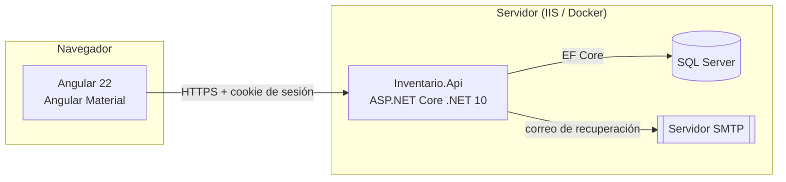
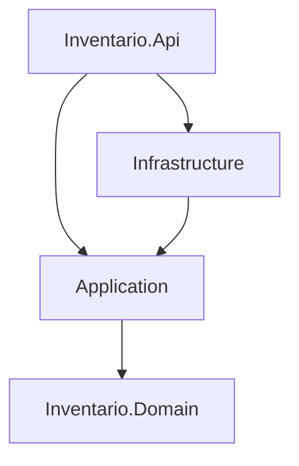

# Arquitectura del Sistema de Inventario TIC

> Documento vivo. Registra **qué** decidimos y **por qué**. Cualquier cambio de arquitectura se anota aquí antes de programarlo.
>
> Versión 0.22 · 25/10/2026 · Cambios: D47 (miniatura y limpieza de metadatos de las fotos); §5.8 al día con la API de fotos (Paso 7D-1).

---

## 1. Propósito y alcance

Sistema web para que **7 sedes** registren y gestionen su inventario de Tecnologías de la Información y Comunicación (TIC): activos, sus componentes (discos, memoria RAM), licencias de software, mantenimientos y asignaciones.

Reglas de negocio que dan forma a la arquitectura:

- Cada sede **solo ve y gestiona su propia información**.
- Cada sede **gestiona sus usuarios y sus roles**.
- Existe un **superadministrador** que ve y gestiona todo.
- Un usuario pertenece a **una sola sede**.
- **No existen transferencias** de activos entre sedes: un activo nunca cambia de sede.

### 1.1 Sedes

| Código | Nombre |
|--------|--------|
| `HUANTA` | Red de Salud Huanta |
| `HUAMANGA` | Red de Salud Huamanga |
| `CENTRO` | Red de Salud Centro |
| `SAN-FRANCISCO` | Red de Salud San Francisco |
| `SAN-MIGUEL` | Red de Salud San Miguel |
| `PUQUIO` | Red de Salud Puquio |
| `CORACORA` | Red de Salud Coracora |

El superadministrador no pertenece a ninguna sede. Se pueden agregar sedes nuevas desde la aplicación (solo el superadmin).

---

## 2. Decisiones tomadas

| # | Tema | Decisión | Motivo |
|---|------|----------|--------|
| D1 | Backend | **.NET 10** (ASP.NET Core) | Versión LTS actual; soportada por el hosting elegido. |
| D2 | Frontend | **Angular 22** (última estable) + **Angular Material** | Pedido del proyecto; Material da componentes accesibles y probados. |
| D3 | Base de datos | **SQL Server** con **Entity Framework Core** | Disponible en el hosting; EF Core da migraciones versionadas. |
| D4 | Arquitectura backend | **Clean Architecture organizada por funcionalidades** + **CQRS ligero** | Responsabilidades separadas, reglas de negocio aisladas de la infraestructura, código fácil de encontrar. |
| D5 | Arquitectura frontend | **Organización por funcionalidades** + **componentes standalone** + **NgRx SignalStore** | Misma lógica que el backend; estado predecible con signals. |
| D6 | Autenticación | **Usuario y contraseña propios** con **ASP.NET Core Identity** y **cookie** HttpOnly | La app sirve el frontend desde el mismo dominio: la cookie es la opción más segura (no hay tokens en el navegador). |
| D7 | Autorización | **Por permisos**; los roles son conjuntos de permisos; **roles configurables por sede** | Permite que cada sede defina sus roles sin tocar código. |
| D8 | Separación por sede | **Columna `SedeId`** en cada tabla de la sede + **filtro global** de EF Core + asignación automática al guardar | Una sola base de datos; imposible olvidar el filtro en un endpoint nuevo. |
| D9 | Catálogos | **Mixtos**: globales (los administra el superadmin) y por sede | Reportes consolidados coherentes entre sedes, sin quitar autonomía local. |
| D10 | Código patrimonial | **Único dentro de cada sede** (no global) | Cada sede ya tiene su propia numeración. |
| D11 | Recuperación de contraseña | **Ambas vías**: enlace por correo (SMTP) y restablecimiento por el administrador | Pedido del proyecto. |
| D12 | Hosting | **SmarterASP.NET** (IIS) ahora; luego **servidor propio con Proxmox** | Toda la configuración por archivos y variables de entorno para que la migración sea solo despliegue. |
| D13 | Mediador | **Sin MediatR** (licencia comercial desde 2025): interfaces de handler propias y registro en DI | Misma claridad, sin dependencia de pago. |
| D14 | Mapeo de objetos | **Mapeo manual** (o Mapperly si crece) | Sin AutoMapper (licencia comercial); el mapeo explícito es más fácil de depurar. |
| D15 | Estilo de API | **Minimal APIs agrupadas por funcionalidad** | Encaja con la organización por funcionalidades; menos ceremonia que los controladores. |
| D16 | Roles por usuario | **Varios roles por usuario**; sus permisos son la **suma** de los de todos sus roles | En las sedes una persona suele cumplir varias funciones; evita crear roles combinados y que un cambio en un rol llegue a todos sus usuarios. |
| D17 | Valores de seguridad | Contraseña de mínimo **10 caracteres**; **bloqueo de 15 min tras 3 intentos fallidos**; sesión que vence a los **30 min sin actividad** | Definidos por el responsable del proyecto. |
| D18 | Sedes iniciales | Las **7 redes de salud** listadas en §1.1 | Datos iniciales del sistema. |
| D19 | Usuario y credenciales | `Usuario` (dominio: sede, nombres, roles) y `CuentaUsuario` (Identity: usuario, correo, contraseña, bloqueo) son tablas distintas con la **misma clave** | El negocio no depende de Identity; Identity puede cambiar sin tocar el dominio. |
| D20 | Datos iniciales | Un **inicializador idempotente** los carga al arrancar la API (no `HasData` en migraciones) | Los roles iniciales de cada sede y, en el Paso 3, el superadministrador necesitan lógica del dominio y una contraseña; así tampoco se generan migraciones de datos. |
| D21 | Correo | Interfaz `IServicioCorreo`: en desarrollo guarda cada correo como archivo HTML (`correos-dev/`); en producción envía por SMTP con el cliente de .NET | Permite probar la recuperación de contraseña sin servidor de correo; cambiar a MailKit no toca los casos de uso. |
| D22 | Superadministrador inicial | Lo crea el inicializador con datos de `Inicializacion:SuperAdmin`; la contraseña inicial va en *user secrets* (desarrollo) o variable de entorno (servidor), es temporal y se exige cambiarla | Ninguna contraseña queda en el código, el repositorio ni la documentación. |
| D23 | Exigencia de sesión | Se aplica al grupo `/api` (`RequireAuthorization`); los endpoints públicos se marcan con `AllowAnonymous()` | Seguro por defecto para la API sin bloquear la documentación (Scalar). |
| D24 | Protección CSRF | Cookie `SameSite=Strict` y, desde el Paso 5A, **token antifalsificación** en todo POST/PUT/PATCH/DELETE a `/api` (incluidos iniciar sesión y recuperar contraseña): `GET /api/cuenta/csrf` lo entrega en la cookie `XSRF-TOKEN` y en el cuerpo; vuelve en la cabecera `X-XSRF-TOKEN`. Sin él, 400 `Seguridad.TokenCsrfInvalido`. Está ligado al usuario: el frontend pide otro al iniciar o cerrar sesión y, si la API lo rechaza, renueva y reintenta una vez | Dos defensas independientes; el reintento cubre la sesión vencida sin molestar al usuario. |
| D25 | Cálculo de permisos | En **cada petición**, con una consulta (roles del usuario → permisos), una sola vez por petición; sin caché entre peticiones | Quitar un rol o un permiso tiene efecto inmediato; la consulta es pequeña. Si el volumen lo exige, se agrega caché después. |
| D26 | Pruebas | **xUnit v3 (4.x)** sobre Microsoft Testing Platform (activado en `global.json`); integración con `WebApplicationFactory` contra una base de pruebas real en SQL Server (`InventarioTIC_Pruebas`), que se recrea en cada ejecución | Las pruebas de aislamiento deben ejercitar el filtro y la protección reales de EF Core sobre SQL Server. |
| D27 | Paso 4 en dos partes | **4A**: permisos, aislamiento y pruebas. **4B**: API de gestión de usuarios, roles y sedes con las reglas contra el escalamiento | Cada parte compila y se prueba por separado; los errores quedan acotados. |
| D28 | Validación de datos | Las reglas de formato (obligatorio, longitud, caracteres) viven **en el dominio**; si se incumplen, el dominio lanza `DominioException` y la Api responde **400** con su mensaje y el código `Dominio.ReglaIncumplida`. Lo que depende de la base o de quién actúa (duplicados, permisos) lo valida Application con `Result` | Una sola fuente de verdad para cada regla; no se repiten validaciones en dos capas. |
| D29 | Contraseña temporal | Al crear un usuario o restablecer su contraseña, el **sistema genera** una contraseña aleatoria de 14 caracteres y la devuelve **una sola vez** al administrador, que se la entrega a la persona. El usuario debe cambiarla al ingresar | El administrador nunca elige ni conoce la contraseña definitiva; no depende de que el correo esté configurado. |
| D30 | Gestión según permisos | **Nadie gestiona a quien tiene más permisos que él**: para editar, cambiar roles, activar/desactivar, restablecer contraseña o desbloquear a un usuario, los permisos del usuario deben estar contenidos en los de quien actúa. Lo mismo para editar o eliminar un rol | Evita, por ejemplo, que alguien con `Usuarios.Gestionar` restablezca la contraseña de una cuenta con más privilegios y se apropie de ella. |
| D31 | Cliente de la API | Generado con **ng-openapi-gen** desde el contrato OpenAPI (funciones por operación + servicio `Api`, con promesas). El contrato (`front/openapi/inventario-api.json`) y el código generado (`front/src/app/api/`) se versionan; se actualizan con `npm run api:actualizar` | Si la API cambia, el frontend no compila hasta ajustarse; los cambios del contrato se ven en cada commit. Sin dependencia de pago y pensado para Angular (usa `HttpClient`, así que pasan los interceptores). |
| D32 | Fuentes e íconos | IBM Plex Sans/Mono y Material Icons **incluidos en la aplicación** (paquetes npm), no desde Google Fonts | Funciona en redes sin internet o con filtros; no se envían datos de los usuarios a terceros. |
| D33 | Desarrollo local | `ng serve` en **https://localhost:4200** con el certificado de desarrollo de .NET exportado (`npm run certificado`) y un proxy de `/api` a `https://localhost:7180` | Mismo esquema que producción (HTTPS, un solo sitio, cookie `SameSite=Strict`); el enlace de "restablecer contraseña" ya apunta a esa dirección. |
| D34 | Pruebas del frontend | **Vitest** (el ejecutor por defecto de Angular 22) con `HttpTestingController` para probar interceptores y stores sin API | Rápido y sin navegador. |
| D35 | Menú y rutas | El menú se define en un solo lugar (`front/src/app/core/layout/menu.ts`): de ahí salen las opciones visibles (según los permisos de la sesión) y las rutas con su guard de permiso. Las secciones aún no construidas muestran "disponible en una próxima versión" | Un permiso nuevo o una pantalla nueva se agregan en un solo sitio; el menú y la protección de rutas no se desalinean. |
| D36 | Sede del superadministrador | Selector en el encabezado: "Todas las sedes" (datos consolidados) o una sede (las pantallas se filtran a ella). Se recuerda en la pestaña del navegador. Los usuarios de sede no lo ven: siempre trabajan en la suya | Revisar una sede concreta sin perder la vista consolidada. |
| D37 | API de catálogos | Una sola API y un solo conjunto de casos de uso para todos los catálogos (`/api/catalogos/{tipo}`), con una tabla y una entidad por catálogo. Cada catálogo se describe en `Application/Catalogos/DefinicionesCatalogo.cs` | Agregar un catálogo nuevo es una entidad, su configuración y una línea en las definiciones; el frontend reutiliza una sola pantalla. |
| D38 | Fotos de los activos | Hasta **6 fotos por activo**, una marcada como principal. Los archivos se guardan en una **carpeta del servidor fuera de la web pública** (detrás de la interfaz `IAlmacenArchivos`), y en la base solo sus datos. Se suben y se entregan por endpoints de la misma API, separados de la ficha (§5.8) | SQL Server Express limita cada base a 10 GB; separar las fotos de la ficha evita perder datos si una subida falla y mantiene ligeras las listas. La interfaz permite cambiar de almacenamiento (Proxmox) sin tocar el resto. |
| D39 | Establecimientos | Tabla maestra de **establecimientos de salud** (496 al inicio), cada uno de **una sola sede**. Cada activo pertenece a un establecimiento y solo guarda su referencia. La mantiene el superadministrador; se carga desde Excel (§5.9) | Los datos del establecimiento se escriben una vez y se corrigen en un solo lugar; un usuario de sede solo elige establecimientos de su red. |
| D40 | Ubicación física | Texto libre dentro del activo ("Piso 2, oficina 204"). **Se retira el catálogo de ubicaciones** del Paso 6B; las áreas siguen como catálogo de la sede | La ubicación depende de cada local; un catálogo por sede no sirve para decenas de establecimientos. |
| D41 | Discos y memoria RAM | Una fila por disco y por módulo. Tipo, capacidad, uso y velocidad se **eligen de listas fijas** definidas en el dominio; la velocidad de la RAM se ofrece según su tipo. La capacidad de un disco admite "Otra" para casos raros (§5.10) | Evita errores de registro (500 por 512, TB por GB) y permite sumar totales confiables. |
| D42 | Excel | **ClosedXML** (licencia MIT) para importar establecimientos y, más adelante, para la exportación a Excel | Formato que los usuarios ya tienen; una sola librería para leer y escribir. |
| D43 | Ficha técnica por tipo | Cada **tipo de activo** indica qué características técnicas lleva: **Cómputo** (todas, con discos y RAM), **Red** (solo nombre de equipo, IP y MAC) o **Ninguna**. Los tipos iniciales la traen asignada por nombre; el superadministrador la cambia en Catálogos generales. La API rechaza datos que no correspondan al tipo (`Activos.DatosNoCorresponden`) | La pantalla muestra solo las secciones que aplican (un monitor no tiene IP ni discos) y la base no acumula datos sin sentido. Que sea un dato del catálogo permite agregar tipos nuevos sin cambiar código. |
| D44 | Procesador y generación | El procesador se elige del catálogo general **Procesadores** (familias: Intel Core i5, AMD Ryzen 7…) y la generación, de la lista que ofrece su familia: **Intel Core** 1.ª a 14.ª generación, **Intel Core Ultra** Serie 1 a 3, **AMD Ryzen** Serie 1000 a 9000, o **ninguna** (Celeron, Xeon, Apple…). Las familias nuevas toman su lista por el nombre y el superadministrador la cambia en Catálogos generales. Se guarda el código de la generación ("13"); la API rechaza una generación que no sea de la familia (`Activos.GeneracionInvalida`). Reemplaza los textos libres "procesador" y "velocidad o generación" | Escrito a mano, la misma generación terminaba como "13", "13.ª" o "treceava" y no se podía filtrar ni contar. Que la familia indique su lista permite agregar procesadores sin cambiar el programa. |
| D45 | Listas y sugerencias en la ficha | Se eligen de lista: **antivirus o EDR** (catálogo general), **tarjeta gráfica** (Integrada o Dedicada; el modelo solo si es dedicada), **pantalla** (medidas comunes u "Otra…") y **puertos** y **accesorios** (se marcan varios de listas fijas; se guardan como nombres separados por comas). Siguen escritos pero **sugieren lo ya registrado en la red**, lo más usado primero: modelo (según la marca), proveedor, dominio, versión del sistema operativo (según el sistema), ubicación física (según el establecimiento) y marca y modelo de discos y RAM | Lo que se repite mucho y tiene pocas variantes se elige, para poder contar y filtrar. Lo que tiene demasiados valores o cambia seguido se sigue escribiendo, pero las sugerencias evitan las variantes ("Latitude 5440" y "latitude5440"). |
| D46 | Elegir escribiendo y agregar al catálogo | Los catálogos largos (tipo de activo, marca, área, procesador, sistema operativo, antivirus; y en los filtros del inventario, establecimiento y tipo) se eligen **escribiendo parte del nombre**: la lista se acorta mostrando primero los que empiezan así, sin distinguir mayúsculas ni tildes, pero el valor siempre es uno del catálogo; lo escrito que no existe se descarta con un aviso. Las listas cortas (estado, criticidad, tipos de disco o RAM) siguen como listas. Quien ya puede modificar ese catálogo ve además **"Agregar «…» al catálogo"**: se confirma en un diálogo que avisa nombres iguales o parecidos y deja elegir la ficha técnica (tipos) o las generaciones (procesadores); los catálogos generales, solo el superadministrador; las áreas, también el administrador de la red | En listas de decenas de elementos, desplazarse es lento (sobre todo en el celular) y con dos o tres letras queda una opción. Agregar sin salir del formulario evita perder lo escrito; usa la misma API y los mismos permisos que Catálogos generales. |
| D47 | Miniatura y limpieza de las fotos | Con cada foto (reducida en el navegador a 1600 px; no se guarda el original) se sube una **miniatura** de unos 320 px, que usan la lista y las tarjetas. El servidor reconoce el formato por el contenido y a las **JPEG les quita los metadatos** (EXIF con ubicación GPS y modelo del celular, XMP, comentarios; conserva el perfil de color). Las fotos se gestionan con `Activos.Editar`; en el formulario se suben al guardar y desde la ficha, al momento | La lista de 25 activos con fotos de 300 KB pesaría 7 MB; con miniaturas, menos de medio MB. Reducir en el navegador ya suele quitar el EXIF, pero no se confía en la interfaz: la limpieza en el servidor protege también las fotos subidas por otros medios. |

### Decisiones pendientes de confirmar

| # | Tema | Propuesta |
|---|------|-----------|
| P2 | Datos del servidor SMTP | Se configuran en el despliegue (servidor, puerto, usuario, remitente). |

---

## 3. Visión general



El frontend compilado se publica **dentro** de la API (carpeta `wwwroot`). Un solo dominio y un solo despliegue: sin CORS y con la cookie protegida por `SameSite=Strict`.

---

## 4. Estructura del repositorio

```
Inventario TIC/
├─ docs/
│  └─ ARQUITECTURA.md          ← este documento
├─ back/                        ← solución .NET 10
│  ├─ src/
│  │  ├─ Inventario.Domain/
│  │  ├─ Inventario.Application/
│  │  ├─ Inventario.Infrastructure/
│  │  └─ Inventario.Api/
│  └─ tests/
│     ├─ Inventario.Domain.Tests/
│     ├─ Inventario.Application.Tests/
│     ├─ Inventario.Api.IntegrationTests/
│     └─ Inventario.ArchitectureTests/
└─ front/                       ← aplicación Angular 22
   └─ src/app/
      ├─ core/
      ├─ shared/
      ├─ features/
      └─ api/
```

---

## 5. Backend

### 5.1 Capas y dependencias



| Capa | Contiene | No puede |
|------|----------|----------|
| **Domain** | Entidades (`Activo`, `Disco`, `Sede`…), objetos de valor, reglas puras, excepciones de dominio. | Depender de ninguna otra capa ni de EF Core, ASP.NET o librerías externas. |
| **Application** | Casos de uso por funcionalidad: comandos, consultas, handlers, validadores, DTOs, interfaces (`IAppDbContext`, `IUsuarioActual`, `IEmailSender`). | Conocer SQL Server, HTTP ni detalles de Identity. |
| **Infrastructure** | `AppDbContext`, configuraciones de EF Core, migraciones, Identity, envío de correo, interceptores. | Contener reglas de negocio. |
| **Api** | Endpoints (Minimal APIs), autenticación, autorización, manejo global de errores, OpenAPI, archivos del frontend. | Contener lógica de negocio: solo recibe, delega y responde. |

Estas reglas se **verifican automáticamente** con pruebas de arquitectura (`Inventario.ArchitectureTests`).

### 5.2 Organización por funcionalidades

Dentro de `Application` (y de los endpoints en `Api`), cada funcionalidad tiene su carpeta:

```
Inventario.Application/
├─ Activos/
│  ├─ Crear/
│  │  ├─ CrearActivoCommand.cs
│  │  ├─ CrearActivoHandler.cs
│  │  └─ CrearActivoValidator.cs
│  ├─ Editar/
│  ├─ ObtenerFicha/
│  │  ├─ ObtenerFichaQuery.cs
│  │  ├─ ObtenerFichaHandler.cs
│  │  └─ FichaActivoDto.cs
│  └─ Listar/
├─ Sedes/
├─ Usuarios/
├─ Roles/
├─ Catalogos/
└─ Common/            ← interfaces y piezas compartidas
```

### 5.3 CQRS ligero

- **Comando**: cambia datos (`CrearActivo`, `RestablecerContraseña`). Devuelve un `Result`.
- **Consulta**: solo lee (`ListarActivos`, `ObtenerFicha`). Usa `AsNoTracking` y proyecta directo a DTO.
- Interfaces propias:

```csharp
public interface ICommandHandler<TCommand, TResult> { Task<Result<TResult>> Handle(TCommand command, CancellationToken ct); }
public interface IQueryHandler<TQuery, TResult>   { Task<Result<TResult>> Handle(TQuery query, CancellationToken ct); }
```

- La validación (FluentValidation) se ejecuta antes del handler mediante un **decorador** registrado en DI.
- Misma base de datos para lectura y escritura: es una separación **de código**, no de infraestructura.

### 5.4 Acceso a datos

- **Sin repositorio genérico.** EF Core ya implementa los patrones Repository y Unit of Work. Los handlers usan `IAppDbContext` (interfaz definida en Application, implementada en Infrastructure).
- Configuración de cada entidad en su propia clase `IEntityTypeConfiguration<T>`.
- Migraciones versionadas en `Infrastructure/Persistence/Migrations`.

### 5.5 Errores

- **Errores esperados** (reglas de negocio, validación, no encontrado, sin permiso): se devuelven como `Result` con un código de error y se traducen a respuestas HTTP con formato estándar **ProblemDetails** (RFC 9457).
- **Errores inesperados**: los captura un manejador global, se registran en el log con un identificador y el usuario ve un mensaje genérico con ese identificador (nunca detalles internos).

### 5.6 Separación por sede (multi-sede)

Es la pieza de seguridad más importante del sistema.

1. **`IUsuarioActual`** expone `UsuarioId`, `SedeId` (nulo para el superadmin), `EsSuperAdmin` y `EsProcesoInterno` (sin petición HTTP: datos iniciales, migraciones). Se lee **siempre de la sesión** del servidor, nunca de datos enviados por el navegador. Los permisos se consultan con `IPermisosUsuarioActual`.
2. Toda entidad de una sede implementa `IPerteneceASede { Guid SedeId }`.
3. **Filtro global de EF Core** (`AppDbContext`), evaluado en cada consulta:

   | Entidad | Un usuario de sede ve | Superadmin y procesos internos | Petición anónima |
   |---|---|---|---|
   | `IPerteneceASede` (activos, licencias…) | Solo los de su sede | Todo | Nada |
   | `Sede` | Solo la suya | Todas | Nada |
   | `Usuario` | Solo los de su sede (nunca al superadmin) | Todos | Nada |
   | `Rol` | Los de su sede y los del sistema | Todos | Nada |
4. **Interceptores de guardado**:
   - `ProteccionSedeInterceptor` (última barrera): un usuario de sede no puede crear, modificar ni borrar registros de otra sede ni registros sin sede (como los roles del sistema), y **nadie** puede cambiar la sede de un registro (no hay transferencias). Ante una violación cancela todo el guardado con `ViolacionAislamientoException` (error 500 genérico, queda en el log). La sede de un registro nuevo la fija el caso de uso desde la sesión; el interceptor lo verifica.
   - `AuditoriaInterceptor`: rellena `CreadoPor`, `CreadoEn`, `ModificadoPor` y `ModificadoEn`.
5. Cualquier excepción al filtro (`IgnoreQueryFilters()`) lleva un comentario `// Excepción revisada al filtro de sede: ...`. Hoy existen solo en el inicio de sesión, la recuperación de contraseña, el armado de la sesión y el cálculo de permisos, siempre buscando por el identificador del propio usuario.
6. **Pruebas de aislamiento** obligatorias (ver §8).

### 5.7 Catálogos

| Globales (superadmin, permiso `Catalogos.GestionarGlobales`) | Por sede (permiso `Catalogos.GestionarSede`) |
|---|---|
| Tipos de activo, marcas, estados del activo, sistemas operativos, tipos de licencia | Áreas o dependencias |

- **Implementados en el Paso 6B.** El catálogo de ubicaciones físicas se retira en el Paso 6D (D40). Los tipos de mantenimiento se agregarán con su módulo.
- Cada catálogo es una tabla en el esquema `catalogos` con nombre y estado (activo o desactivado). Los de sede llevan `SedeId` (`IPerteneceASede`), así que usan el mismo filtro y la misma protección de §5.6.
- Nombre único dentro del catálogo (y de la sede, en los de sede).
- **No se eliminan: se desactivan.** Un elemento desactivado deja de ofrecerse al registrar, pero los registros que ya lo usan lo conservan.
- Una sola API para todos: `/api/catalogos/{tipo}` (D37). Consultarlos solo exige sesión (se necesitan al registrar activos); modificarlos, el permiso del catálogo.
- Los catálogos generales arrancan con valores iniciales (`Domain/Catalogos/CatalogosIniciales.cs`), que se cargan una sola vez, cuando el catálogo está vacío.

### 5.8 Fotos de los activos (D38)

- **Cuántas:** hasta 6 por activo; una es la **principal** (se muestra en la lista). Al quitar la principal, pasa a serlo la siguiente.
- **Cómo se obtienen:** con el selector de archivos del navegador (`accept="image/*"`). En el celular ofrece **tomar foto** con la cámara (el permiso lo pide el propio navegador; exige HTTPS) o elegir de la galería; en la computadora, cargar archivos.
- **Antes de subir**, el navegador reduce la foto (lado mayor de 1600 px, JPEG o WebP) y prepara una **miniatura** de unos 320 px (D47). Así la foto pesa unos cientos de KB y la miniatura unas decenas.
- **Endpoints** (misma API, dentro de activos):

  | Acción | Endpoint | Permiso |
  |---|---|---|
  | Listar | `GET /api/activos/{id}/fotos` (la principal primero) | `Activos.Ver` |
  | Ver la imagen | `GET /api/activos/{id}/fotos/{fotoId}/archivo` (`?miniatura=true` para la pequeña) | `Activos.Ver` |
  | Subir | `POST /api/activos/{id}/fotos` (multipart: `archivo`, `miniatura`, `descripcion`) | `Activos.Editar` |
  | Cambiar la descripción | `PUT /api/activos/{id}/fotos/{fotoId}` | `Activos.Editar` |
  | Marcar como principal | `POST /api/activos/{id}/fotos/{fotoId}/principal` | `Activos.Editar` |
  | Quitar | `DELETE /api/activos/{id}/fotos/{fotoId}` | `Activos.Editar` |

  La lista del inventario trae `fotoPrincipalId` para mostrar la miniatura sin otra consulta.
- **Validación en el servidor:** solo JPG, PNG o WebP, comprobados por el **contenido** del archivo (no por la extensión ni por el tipo que declara el navegador); hasta 4 MB la foto y 512 KB la miniatura; a las JPEG se les quitan los metadatos (D47); descripción opcional de hasta 60 caracteres; el nombre en disco lo genera el sistema (nunca el que envía el usuario). Errores: `Fotos.TipoNoValido`, `Fotos.MuyGrande`, `Fotos.Danada`, `Fotos.SinArchivo`, `Fotos.SinMiniatura` (400) y `Fotos.Maximo` (422).
- **Aislamiento:** la tabla `inventario.FotosActivo` pertenece a la sede (`IPerteneceASede`) y las fotos solo se entregan por la API, con sesión y el filtro de §5.6: otra red recibe 404. Nunca hay enlaces públicos. Se responden con `X-Content-Type-Options: nosniff` y `Cache-Control: private` de un año (una foto nunca cambia: otra imagen es otra foto).
- **Almacenamiento:** `AlmacenArchivosEnDisco` (detrás de `IAlmacenArchivos`), carpeta `Almacenamiento:CarpetaFotos` fuera de `wwwroot` (en desarrollo `fotos-dev`, junto al proyecto Api), organizada como `{sede}/{activo}/{foto}.jpg` y `{foto}-mini.jpg`. Rechaza cualquier clave que salga de la carpeta. Los archivos se escriben antes de guardar el registro (y se borran si este falla) y se borran después de quitar el registro: como mucho queda un archivo sin uso, nunca una foto sin archivo. Al eliminar un activo se eliminan sus fotos y archivos. El almacenamiento es reutilizable para otros módulos (por ejemplo, evidencias de mantenimiento).
- **En la pantalla:** en el formulario, al pulsar *Guardar* se guarda la ficha y luego se suben las fotos nuevas una por una, con su avance; si una falla, la ficha ya quedó guardada y solo se reintenta esa foto. Desde la ficha, las fotos se suben, describen, marcan o quitan al momento.

### 5.9 Establecimientos (D39)

| Dato | Tipo | Regla |
|---|---|---|
| Id_Establecimiento | número | Obligatorio y único. Es el identificador de la lista oficial, no la clave interna de la tabla |
| Código único | número | Obligatorio y único. Se busca por él al registrar un activo |
| Nombre | texto | Obligatorio |
| Categoría | texto | Ejemplo: II-1 |
| Microred | texto | |
| Red | sede | Al importar, el texto de la red se convierte en una de las 7 sedes; si no corresponde a ninguna, la fila se rechaza |
| Provincia, distrito | texto | |
| Ubigeo | texto de 6 dígitos | Conserva el 0 inicial (050601) |

- **Implementado en el Paso 6D.** Tabla `organizacion.Establecimientos`; API en `/api/establecimientos`.
- Pertenece a la sede (`IPerteneceASede`): un usuario de sede solo ve y elige los de su red; el superadministrador, todos.
- **Lo mantiene el superadministrador** (permiso exclusivo `Establecimientos.Gestionar`): agregar, editar y desactivar. No se elimina si tiene activos; desactivado, deja de ofrecerse al registrar.
- **Importación desde Excel** con una plantilla descargable. Se revisan todas las filas antes de guardar (sede reconocida, códigos sin repetir, ubigeo de 6 dígitos) y se informa qué filas tienen errores. Si una fila trae un Id_Establecimiento que ya existe, se actualizan sus datos (sin cambiar de red). **Si alguna fila tiene errores no se guarda nada.** Límites: 5 MB y 5000 filas por archivo. Las columnas se reconocen por su encabezado, en cualquier orden; un ubigeo numérico al que Excel quitó el 0 inicial se completa.

### 5.10 Ficha del activo

Campos acordados para el Paso 7A, tomados de la plantilla `Fichas_Tecnicas_Inventario_TIC.xlsx` (✔ = obligatorio).

| Grupo | Campos |
|---|---|
| Identificación | Establecimiento ✔ (búsqueda por código único o nombre), código patrimonial ✔ (**único por sede**), tipo de activo ✔, marca ✔, modelo ✔, N° de serie (avisa si se repite), descripción |
| Ubicación y responsable | Área ✔ (catálogo de la sede), ubicación física (texto, D40), responsable (texto; pasará a salir de la asignación vigente cuando exista ese módulo) |
| Estado | Estado ✔ (catálogo), conservación ✔ (Nuevo, Bueno, Regular, Malo), criticidad (Alta, Media, Baja) |
| Adquisición y garantía | Fecha de adquisición, proveedor, N° de OC o factura, tipo de adquisición (Compra, Arrendamiento, Donación, Transferencia, Comodato), valor (S/), vida útil (años), fin de garantía, observaciones |
| Técnicos (solo equipos de cómputo) | Procesador, velocidad o generación, N° de núcleos, tarjeta gráfica, pantalla (pulgadas), sistema operativo (catálogo), versión del SO, hostname, dominio o grupo de trabajo, IP, MAC, antivirus o EDR, disco cifrado (Sí/No), puertos principales, accesorios incluidos |
| Discos (D41) | Ranura, tipo (SSD SATA, NVMe, HDD, Híbrido), capacidad (lista de GB/TB u "Otra"), marca y modelo, N° de serie, uso (Sistema, Datos, Respaldo) |
| Memoria RAM (D41) | Ranura, tipo (DDR3, DDR3L, DDR4, DDR5, LPDDR4X, LPDDR5), capacidad (2 a 64 GB), velocidad (lista según el tipo), marca y modelo |

- **Se calculan, no se escriben:** RAM total, almacenamiento total, antigüedad, estado de la garantía, vida útil restante y situación de renovación.
- **Para pasos posteriores:** los campos propios de servidores, red y periféricos (mientras tanto se registran con los campos comunes); licencias, mantenimiento y asignaciones en sus módulos; fotos en el 7D (§5.8).

**Implementado en el Paso 7A** (tablas `inventario.Activos`, `inventario.Discos` e `inventario.ModulosRam`; API en `/api/activos`):

- **La sede no se envía:** es la del establecimiento elegido. El área debe ser de esa misma red. Al editar, el establecimiento puede cambiar dentro de la red, nunca a otra (no hay transferencias).
- **Referencias activas:** establecimiento, área y elementos de catálogo deben existir y estar activos. Un elemento ya desactivado se acepta si el activo ya lo tenía, para poder editar sus otros datos.
- **Código patrimonial:** se guarda sin espacios a los lados y en mayúsculas; único por sede (índice único `SedeId + CodigoPatrimonial`).
- **Número de serie repetido:** no es un error; `GET /api/activos/serie?numero=` devuelve los activos de la sede que ya lo usan, para avisar antes de guardar.
- **Listas fijas** (conservación, criticidad, tipo de adquisición, tipos y usos de disco, tipos, capacidades y velocidades de RAM): definidas en `Domain/Activos/ListasActivo.cs` y entregadas por `GET /api/activos/listas` con sus textos. Viajan en la API y se guardan en la base como texto (`"Bueno"`, `"Nvme"`).
- **Validaciones de la ficha:** IP (IPv4 completa o IPv6), MAC (se guarda como `A4:BB:6D:12:34:56`), nombre de equipo, rangos de valor, vida útil (1 a 50 años), núcleos y pantalla; el fin de garantía no es anterior a la adquisición; la fecha de adquisición no es futura; hasta 16 discos y 32 módulos de RAM.
- **Cálculos:** la entidad guarda la **fecha de renovación** (adquisición + vida útil) para poder filtrar en la base; antigüedad, garantía (vigente o vencida), vida útil restante y situación de renovación (vigente, próximo a renovar con 1 año o menos, renovar) se calculan a la fecha del servidor.
- **Lista del inventario** paginada (25 por página, hasta 100), ordenada por código, con filtros por sede (superadministrador), establecimiento, tipo, área, estado, garantía y renovación, y búsqueda por código, serie, modelo, responsable, marca, IP o nombre de equipo (estas dos desde el 7C-3).
- **Eliminar** (`Activos.Eliminar`) es para registros hechos por error; un equipo que ya no se usa se marca con el estado "De baja".
- **Ficha técnica por tipo (D43):** columna `Ficha` en `catalogos.TiposActivo` (`Computo`, `Red`, `Ninguna`). Al arrancar, los tipos que no la tienen la reciben según su nombre (Laptop, PC de escritorio, All-in-one, Servidor, Tablet y Workstation → Cómputo; Impresora, Multifuncional, Escáner, Switch, Router, Access point, Firewall y Teléfono IP → Red; los demás → Ninguna). `PUT /api/catalogos/tipos-activo/{id}/ficha` la cambia (`Catalogos.GestionarGlobales`). Los activos ya registrados conservan sus datos; la ficha (`GET /api/activos/{id}`) informa la del tipo para que la pantalla elija las secciones.

**Implementado en el Paso 7C-1** (Angular, `features/activos`):

- **Lista** en `/inventario`: búsqueda (espera a que se deje de escribir) y filtros por establecimiento, tipo, estado, garantía y renovación. Los filtros y la página viven en la dirección (`?buscar=dell&garantia=Vencida&pagina=2`), así que se pueden recargar, compartir y recuperar al volver de una ficha. Con "Todas las sedes" se muestra la red de cada activo y no se ofrece el filtro de establecimiento. En pantallas angostas las filas pasan a tarjetas y los filtros se abren con un botón.
- **Ficha** en `/inventario/{id}`, solo lectura: secciones según la ficha del tipo, ciclo de vida (antigüedad frente a vida útil, garantía y renovación prevista) y adquisición. Editar y Eliminar según permiso; eliminar pide confirmación.
- **Catálogos generales:** en Tipos de activo, una columna para elegir la ficha de cada tipo (con confirmación).

**Implementado en el Paso 7C-2** (formulario en `/inventario/nuevo` y `/inventario/{id}/editar`):

- **Establecimiento** por búsqueda (código único o parte del nombre), solo los activos de la red; el superadministrador con "Todas las sedes" busca en todas. Al editar solo se ofrece la red del activo. Las áreas son las de la red del establecimiento elegido.
- **Secciones según la ficha del tipo (D43):** al elegir el tipo se muestran las características que lleva. Lo escrito en secciones que el tipo no lleva no se valida ni se envía, y la pantalla avisa si se descartará algo.
- **Discos y RAM:** filas que se agregan y quitan, con totales; capacidades de la lista (en discos, "Otra…" para escribir los GB); la velocidad de la RAM se elige entre las de su tipo y se borra si deja de corresponder.
- **Validaciones junto al campo** que adelantan las de la API (obligatorios, largos, IP, MAC, fechas, rangos); la API vuelve a validar todo. Un código patrimonial repetido se marca en su campo.
- **Avisos:** número de serie ya registrado en la red (no impide guardar), renovación prevista según la fecha de adquisición y la vida útil.
- **Cambios sin guardar:** pregunta antes de salir por un enlace o con Cancelar; al recargar o cerrar la pestaña, el navegador muestra su propia pregunta.
- Un elemento de catálogo desactivado se sigue mostrando (marcado) si el activo ya lo tenía.

---

## 6. Seguridad

### 6.1 Autenticación

- **ASP.NET Core Identity** con usuario y contraseña propios. Las contraseñas se guardan con hash PBKDF2 (nunca en texto plano).
- **Cookie de sesión** `InventarioTIC.Sesion`: `HttpOnly`, `Secure`, `SameSite=Strict`, vence a los 30 minutos sin actividad y se renueva con cada petición. La cookie lleva el identificador, la sede, la marca de superadministrador y la de cambio obligatorio; **no** lleva permisos.
- **Validación periódica de la sesión** (cada minuto): si cambia la contraseña de un usuario, sus otras sesiones abiertas se cierran.
- **Límite de peticiones**: 10 por minuto por dirección IP en iniciar sesión y recuperación de contraseña (HTTP 429 al superarlo).
- **Protección CSRF**: cookie `SameSite=Strict` desde el Paso 3 y, desde el Paso 5A, token antifalsificación en cada petición que modifica datos (D24).
- **Política de contraseñas**: mínimo 10 caracteres, con mayúscula, minúscula y número.
- **Bloqueo** tras **3 intentos fallidos** durante 15 minutos (D17). El desbloqueo es automático al vencer el plazo, y el administrador de sede (o el superadmin) puede desbloquear antes. Como un umbral bajo facilita que alguien bloquee cuentas ajenas a propósito, el inicio de sesión tiene además límite de peticiones por dirección IP (§6.4) y los bloqueos quedan registrados.
- **Cuentas nuevas y restablecidas** llevan contraseña temporal y **cambio obligatorio** en el primer ingreso.
- **Recuperación de contraseña**:
  - *Por correo*: enlace de un solo uso que vence en 1 hora. La respuesta es la misma exista o no el correo, para no revelar qué cuentas existen.
  - *Por el administrador*: genera una contraseña temporal; el usuario debe cambiarla al entrar.
- Las **claves de protección de datos** de ASP.NET (que cifran la cookie) se guardan en la base de datos, para que las sesiones no se pierdan cuando el hosting recicla la aplicación.

### 6.2 Autorización por permisos

- Los **permisos** están definidos en el código (no se inventan desde la interfaz):
  `Activos.Ver`, `Activos.Crear`, `Activos.Editar`, `Activos.Eliminar`, `Licencias.Ver`, `Licencias.Gestionar`, `Mantenimiento.Ver`, `Mantenimiento.Gestionar`, `Asignaciones.Ver`, `Asignaciones.Gestionar`, `Catalogos.GestionarSede`, `Usuarios.Ver`, `Usuarios.Gestionar`, `Roles.Ver`, `Roles.Gestionar`, y los exclusivos del superadmin: `Sedes.Gestionar`, `Catalogos.GestionarGlobales`, `Establecimientos.Gestionar`, `Administradores.Gestionar`.
- Un usuario puede tener **varios roles** (D16). Sus permisos efectivos son la **unión** de los permisos de todos sus roles. La pantalla del usuario muestra ese resumen para que se entienda qué puede hacer sin sumar roles a mano.
- Cada endpoint declara el permiso que exige (`.RequirePermiso(Permisos.Activos.Crear)`).
- Los permisos del usuario se calculan en el servidor en cada petición (una consulta por petición, D25). Así, quitar un permiso o un rol tiene efecto inmediato. Un usuario desactivado no tiene ningún permiso.
- Sin sesión el endpoint responde **401**; con sesión pero sin el permiso, **403**.
- Los roles **no** usan la tabla de roles de Identity (exige nombres únicos globales y "Editor" existirá en cada sede); se usan tablas propias.

### 6.3 Roles

| Rol | Tipo | Quién lo asigna | Alcance |
|-----|------|-----------------|---------|
| **Superadmin** | Sistema | — | Todas las sedes y todos los permisos. |
| **Administrador de sede** | Sistema | Solo el superadmin | Todo dentro de su sede, incluidos usuarios y roles. |
| **Editor** | Inicial de cada sede (editable) | Administrador de sede | Registrar y modificar inventario. |
| **Consulta** | Inicial de cada sede (editable) | Administrador de sede | Solo lectura. |
| *Roles propios* | Por sede | Administrador de sede | Lo que se marque. |

**Reglas contra el escalamiento de privilegios** (validadas en el servidor):

1. Un administrador de sede solo puede otorgar permisos **que él mismo tiene**, tanto al armar un rol como al asignar roles a un usuario.
2. Los permisos exclusivos del superadmin **nunca** se pueden asignar a un rol de sede.
3. Nadie de una sede puede crear, editar ni asignar el rol **Administrador de sede**.
4. Un usuario solo puede recibir roles **de su propia sede** (o roles del sistema, si los asigna el superadmin).
5. Los roles de una sede son **invisibles** para las demás.
6. Nadie puede modificar sus propios roles.
7. El rol **Superadmin** no se combina con roles de sede.
8. Nadie gestiona a un usuario que tiene **más permisos que él**, aunque esté desactivado (D30). Tampoco edita ni elimina un rol con permisos que él no tiene.
9. A un **administrador de sede** solo lo gestiona el superadmin (editarlo, desactivarlo, restablecer su contraseña, quitarle el rol).
10. Nadie se gestiona a sí mismo desde la gestión de usuarios (roles, estado, contraseña); cada uno cambia su contraseña desde su cuenta.
11. La cuenta del superadmin no se gestiona desde la API: no aparece en los listados ni se puede desactivar.

Dónde está cada regla: las que solo dependen del usuario y del rol (2, 4, 7) en el **dominio** (`Usuario.AsignarRoles`, `Rol.DefinirPermisos`); las que dependen de quién actúa (1, 3, 6, 8, 9, 10, 11) en **Application** (`ReglasDeGestion`); la 5, en el filtro de sede (§5.6).

**Al desactivar** un usuario o una sede, sus sesiones abiertas se cierran (se renueva el sello de seguridad de la cuenta; el validador lo detecta en menos de un minuto). Los permisos de un usuario desactivado desaparecen al instante (§6.2).

### 6.4 Otras medidas

- Cabeceras de seguridad: HSTS, `Content-Security-Policy`, `X-Content-Type-Options`, `Referrer-Policy`.
- Límite de peticiones en inicio de sesión y recuperación de contraseña.
- Cadenas de conexión y credenciales SMTP **fuera del repositorio** (variables de entorno o `appsettings.Production.json` no versionado).
- Registro de auditoría de cambios (fase de endurecimiento).

---

## 7. Frontend

### 7.1 Estructura

```
front/src/app/
├─ core/                      ← se carga una sola vez
│  ├─ auth/                   ← sesión, guard de permisos, servicio de usuario actual
│  ├─ http/                   ← interceptores (errores, CSRF, sesión vencida)
│  └─ layout/                 ← barra lateral, encabezado, selector de sede (superadmin)
├─ shared/                    ← sin lógica de negocio
│  ├─ ui/                     ← insignia de estado, tabla, tarjeta de indicador, confirmación
│  └─ pipes/                  ← fecha dd/mm/aaaa, moneda S/
├─ features/                  ← una carpeta por funcionalidad, carga diferida
│  ├─ resumen/
│  ├─ activos/
│  │  ├─ pages/               ← componentes contenedores (rutas)
│  │  ├─ components/          ← componentes de presentación
│  │  ├─ data/                ← store (SignalStore) y acceso a la API
│  │  └─ activos.routes.ts
│  ├─ licencias/
│  ├─ sedes/
│  ├─ usuarios/
│  ├─ roles/
│  └─ catalogos/
└─ api/                       ← cliente generado desde OpenAPI (no se edita a mano)
```

### 7.2 Patrones

- **Componentes standalone** y **rutas con carga diferida** por funcionalidad.
- **Contenedor / presentación**: la página obtiene datos y coordina; los componentes visuales solo reciben `input()` y emiten `output()`.
- **Estado con NgRx SignalStore**: un store por funcionalidad, con la misma forma en todas (estado, selectores computados, métodos).
- **Cliente de API generado** desde el contrato OpenAPI del backend: si el backend cambia, el frontend no compila hasta actualizarse.
- **Formularios reactivos tipados**; listas dinámicas para discos y módulos de RAM.
- **Guards por permiso** para rutas y una directiva para mostrar u ocultar botones. El servidor siempre tiene la última palabra.
- **Detección de cambios basada en signals** (`OnPush` en todos los componentes).
- Formato regional **es-PE**: fechas `dd/mm/aaaa`, moneda `S/`.

### 7.3 Diseño visual

Angular Material, con un tema propio basado en los bosquejos (barra lateral oscura, acento azul para acciones, verde/ámbar/rojo para estados, códigos en tipografía monoespaciada).

---

## 8. Pruebas

| Proyecto | Qué prueba |
|----------|-----------|
| `Domain.Tests` | Reglas puras (vida útil, garantía, suma de capacidades). |
| `Application.Tests` | Handlers y validadores. |
| `Api.IntegrationTests` | Endpoints reales y filtro/protección de EF Core contra la base `InventarioTIC_Pruebas` en SQL Server (se recrea en cada ejecución). |
| `ArchitectureTests` | Que las capas respeten sus dependencias. |
| Frontend | Pruebas unitarias de stores y componentes; pruebas de punta a punta de los flujos principales. |

**Pruebas de aislamiento entre sedes (obligatorias)**. Con dos sedes A y B, un usuario de A:

- no ve activos, usuarios, roles ni catálogos de B en ningún listado;
- recibe "no encontrado" al pedir por identificador un registro de B;
- no puede editar ni eliminar registros de B;
- no puede crear registros en B indicando su `SedeId`;
- no puede asignarse ni asignar a otros permisos que no tiene;
- no puede asignar a un usuario de A un rol que pertenece a B.

---

## 9. Convenciones

- **Idioma**: conceptos de negocio en español (`Activo`, `Sede`, `CrearActivo`); sufijos técnicos en inglés por convención (`Command`, `Handler`, `Validator`, `Store`).
- **.NET**: `Nullable` activado, advertencias tratadas como errores, analizadores de código, `async` en todo acceso a datos con `CancellationToken`.
- **Angular**: TypeScript estricto, ESLint y Prettier.
- **Commits** con formato convencional (`feat:`, `fix:`, `docs:`…).
- Archivo `.editorconfig` compartido.

---

## 10. Despliegue

| Entorno | Cómo |
|---------|------|
| Desarrollo | `dotnet run` (API) + `ng serve` (Angular con proxy a la API); SQL Server local o LocalDB. |
| SmarterASP.NET | Publicación de la API con el frontend compilado en `wwwroot`; IIS en proceso; base SQL Server del hosting. |
| Proxmox (futuro) | Contenedor Docker o máquina virtual con IIS; misma configuración por variables de entorno. |

Consideraciones del hosting compartido:

- IIS recicla la aplicación: **no** se usan tareas en segundo plano permanentes.
- Las claves de protección de datos se guardan en la base de datos (§6.1).
- Las migraciones se aplican con un script SQL generado (`dotnet ef migrations script --idempotent`), no automáticamente al arrancar.
- La carpeta de fotos (§5.8) va **fuera de `wwwroot`** (variable de entorno `Almacenamiento__CarpetaFotos` con una ruta absoluta) y debe incluirse en las copias de seguridad junto con la base de datos. La cuenta de IIS necesita permiso de escritura en ella. Vigilar la cuota de disco del plan.

### 10.1 Pendientes antes de publicar (endurecimiento)

| Pendiente | Detalle |
|---|---|
| Cifrar las claves de protección de datos | Hoy se guardan en `seguridad.ClavesProteccionDatos` sin una capa extra de cifrado (el registro avisa "No XML encryptor configured"). En producción: `ProtectKeysWithCertificate(...)` con un certificado instalado en el servidor. |
| Cabeceras de seguridad | HSTS, `Content-Security-Policy`, `X-Content-Type-Options`, `Referrer-Policy` (§6.4). |
| Registro de auditoría de cambios | Historial completo de quién cambió qué (§6.4). |
| Correo SMTP real | Datos del servidor de SmarterASP.NET como variables de entorno (D21). |

---

## 11. Plan por pasos

| Paso | Contenido | Verificación |
|------|-----------|--------------|
| **0** | Este documento y la estructura de carpetas | Revisión |
| **1** | Solución .NET con las 4 capas y entidades base (sede, usuario, rol, permiso) | `dotnet build` |
| **2** | Base de datos y primera migración | Migración aplicada en SQL Server |
| **3** | Inicio de sesión, contraseñas, bloqueo y recuperación | Prueba manual (Postman o navegador) |
| **4A** | Permisos por petición, aislamiento entre sedes y proyectos de pruebas | `dotnet test` |
| **4B** | API de gestión de usuarios, roles y sedes con reglas contra el escalamiento | `dotnet test` |
| **5A** | Proyecto Angular 22 + Material: tema, proxy, protección CSRF, cliente generado, sesión, guards e interceptores | `npm test` y página de comprobación en `ng serve` |
| **5B** | Pantallas de inicio de sesión, cambio y recuperación de contraseña; estructura con menú según permisos | Prueba manual en el navegador |
| **6A** | Pantallas de sedes, usuarios y roles (sobre la API del 4B) | Prueba manual en el navegador |
| **6B** | Áreas y ubicaciones (por sede) y catálogos generales: API, migración y pantallas | `dotnet test` y prueba manual |
| **6C** | Catálogos: un solo campo para buscar y agregar (avisa repetidos sin distinguir mayúsculas ni tildes); confirmación en todas las acciones; menú lateral y encabezado fijos al desplazarse; en celular, menú como panel con el botón ☰ | `npm test` y prueba manual |
| **6D** | Establecimientos (D39): tabla, migración, API, importación desde Excel y pantalla del superadministrador; retiro del catálogo de ubicaciones (D40) | `dotnet test`, `npm test` y prueba manual con un Excel |
| **7A** | Activos en el backend (§5.10): ficha técnica con discos y módulos de RAM, migración, API con permisos y aislamiento por sede | `dotnet test` |
| **7B** | Bosquejos de la lista de activos y de la ficha técnica | Revisión en el lienzo de diseño |
| **7C-1** | Ficha técnica por tipo (D43) en la API; lista de activos con búsqueda y filtros, y ficha de solo lectura en Angular | `dotnet test`, `npm test` y prueba manual |
| **7C-2** | Formulario para registrar y editar activos (establecimiento por búsqueda, secciones según la ficha, discos y RAM, aviso de serie repetida, aviso de cambios sin guardar) | `npm test` y prueba de punta a punta |
| **7C-3** | Procesador y generación de lista (D44); búsqueda del inventario por IP y nombre de equipo | `dotnet test`, `npm test` y prueba manual |
| **7C-4** | Antivirus, tarjeta gráfica, pantalla, puertos y accesorios de lista; sugerencias en campos escritos (D45) | `dotnet test`, `npm test` y prueba manual |
| **7C-5** | Catálogos largos que se eligen escribiendo y agregar al catálogo desde el formulario (D46) | `npm test` y prueba manual (también en celular) |
| **7D-1** | Fotos en la API (D38, D47, §5.8): almacenamiento en carpeta, subir con miniatura, principal, descripción, quitar; limpieza de EXIF; `fotoPrincipalId` en la lista | `dotnet test` y prueba en Scalar |
| **7D-2** | Fotos en Angular: reducción y miniatura en el navegador, cámara del celular, fotos en el formulario y galería y visor en la ficha, miniatura en la lista | `npm test` y prueba en celular |

Fases posteriores: licencias, mantenimiento, asignaciones, resumen, exportación a Excel, registro de auditoría y endurecimiento.
